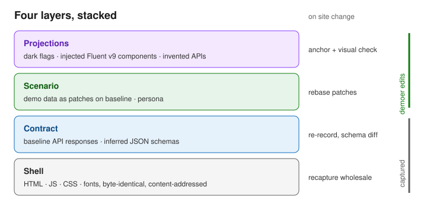
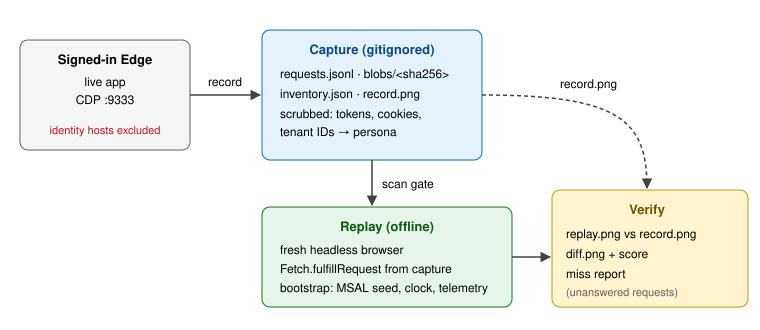

# Mimesia design

## Problem

Demos need a live-looking copy of a large Microsoft web app with controlled data and, sometimes, features that don't ship yet. Rebuilding screens by hand (prior art: `caldova/minimac`) works but scales poorly: every screen is re-authored, and every site update means more rework.

## Approach: record and replay

Capture the real app's bundles as served, without rewriting them. Intercept data calls at the network layer and answer them from fixtures. Edit the data, not the code.

| Layer | Holds | Edited by | On site change |
|---|---|---|---|
| Shell | HTML, JS, CSS, fonts, images as served (decoded); content-addressed, versioned per build | nobody | recapture wholesale |
| Contract | baseline API responses + inferred JSON schema per endpoint | nobody | re-record, schema diff |
| Scenario | demo data as **patches** on the baseline; persona (fake user, tenant) | demoer | rebase patches; conflicts only where touched fields moved; LLM proposes fixes |
| Projections | future features (see below) | demoer | anchor check + visual check flags conflicts |

### Projections

| Kind | How |
|---|---|
| Dark flag | flip a feature flag already in the bundle |
| Injected UI | mount a Fluent UI v9 React component at a DOM anchor, or on a new route |
| Invented API | endpoint that exists only in the scenario |

Declared in a manifest:

| Field | Example |
|---|---|
| `id` | `agent-cost-card` |
| `route` | `/projects/*/overview` |
| `anchor` | CSS selector |
| `mode` | `append` \| `replace` \| `new-route` |
| `component` | path to the component |
| `data` | scenario endpoint(s) it reads |

Projections are visually tagged in verify output so real and projected UI stay distinguishable.

## Diffing site updates

Minified bundle diffs are useless. Diff at meaningful levels:

| Level | Signal |
|---|---|
| API | schema diff per endpoint |
| Visual | per-route screenshot diff from a replayed click script |
| Inventory | routes, feature flags, hosts |

## Record, replay, verify

**Record** attaches to a signed-in browser over CDP, arms *after* the app has loaded, reloads, and stores supported response bodies (decoded) by hash. Streams, WebSockets, and anything else it can't store go to `inventory.json`. **Replay** launches a fresh browser and fulfills requests from the capture. **Verify** screenshots replay and diffs against the recording.

### Fidelity rules

| Rule | Why |
|---|---|
| Bypass and unregister the app's own service workers during record and replay | they can serve stale or live content around interception |
| Disable browser cache during record | every resource must hit the network to be captured |
| Replay fails closed: no request reaches the network | proves the capture is self-contained |
| Report every unmatched request | misses are the main fidelity signal |

### Replay runtime

| Mode | Use |
|---|---|
| CDP `Fetch.fulfillRequest` | spike, in-tool preview |
| Static site + service worker | publish (e.g. Azure Static Web Apps behind real auth) |

Both inject one small **bootstrap** script into the page:

| Concern | Bootstrap does |
|---|---|
| Auth | seed fake MSAL session |
| Clock | pin `Date` to capture time |
| Telemetry | block |
| Hosts | rewrite absolute hosts (service-worker mode) |
| Projections | mount injected components |

Service-worker publish must handle scope, CSP, and cross-origin requests. Out of scope for spike 01.

## Login is not recorded

Arming after load is not enough on its own: reloads can trigger silent renewal. Recording **fails closed**.

| Stage | Rule |
|---|---|
| Record | user signs in first; recording arms after load |
| Record | drop identity hosts: `login.microsoftonline.com`, `login.live.com`, `login.windows.net`, `aadcdn*`, `*.msauth.net`, `*.msftauth.net` |
| Record | drop any request to an OAuth/OIDC path (`/oauth2/`, `/.well-known/openid-configuration`) on any host |
| Record | never persist `Authorization`, `Cookie`, `Set-Cookie`, or `x-ms-*token*` headers |
| Record | refuse an `--out` path that Git would track |
| Scrub | JWTs in bodies, SAS `sig=`, session IDs, real UPN/oid/tenant ID → persona |
| Gate | capture is marked unscanned; `replay` refuses it until `scan` passes |
| Scenario | Graph `/me`, photo, tenant, subscriptions come from the persona |
| Replay | stub residual identity calls: OpenID config, token, silent-renew iframe |

### Fake session (hypothesis, per app)

Browser MSAL does not verify token signatures, so a cached token with the right claims and expiry *should* satisfy `acquireTokenSilent`. Cache keys and metadata vary by MSAL version and direct storage injection is unsupported, so this is an experiment per app and version:

| Order | Technique |
|---|---|
| 1 | MSAL's `loadExternalTokens()` if the app exposes its MSAL instance |
| 2 | seed the version-specific cache keys in localStorage/sessionStorage |
| 3 | stub token endpoints with far-future unsigned JWTs |

Auth adapters are per app, not generic.

## Tooling

| Piece | Choice |
|---|---|
| Core | Rust CLI |
| Browser control | raw CDP via `chromiumoxide` (no Playwright/Node) |
| Record | `Network` + `Fetch` domains |
| Replay | `Fetch.fulfillRequest`; `Page.addScriptToEvaluateOnNewDocument` for bootstrap |
| Screenshots | `Page.captureScreenshot` |
| Anchor picking | `Overlay` inspect mode |
| Click scripts | accessibility tree for semantic steps |
| Image diff | `image` crate, pixelmatch-style |
| Live browser | Edge with `--remote-debugging-port=9333 --user-data-dir=<temp>` |

### Later: desktop app

Tauri app with screens **Record / Scenario / Projections / Updates / Publish**, instrumented with `auditaur` and possibly exposing its own MCP server. WebView2 can expose CDP on Windows; on macOS it drives an external Edge/Chrome. Built only after the spike proves replay fidelity.

## Spike 01 risks

| Risk | Test |
|---|---|
| Fake MSAL session | page renders signed in as persona, no login redirect |
| WebSockets, SSE, iframes, workers, SAS blobs | listed in `inventory.json`; replay miss report |
| Absolute / multi-origin hosts | host-agnostic interception; zero misses |
| Lazy chunks | scripted interaction after load; new chunks show as misses |
| Volatile request params | match key strips volatile params; misses show nearest candidate |
| Leaks | `mimesia scan` gate + unit tests |
| Visual noise | pinned clock, no animations, no telemetry; replay-vs-replay baseline |

## Prior art

| Project | Lesson |
|---|---|
| `caldova/minimac` | hand-built clones are faithful but slow; useful: pinned clock, demo flags via localStorage, attach to signed-in Edge over CDP, typed stores from API responses |
| `morluto/rea` | reverse-engineering MCP, not capture/replay; rejected |
| `sethjuarez/auditaur` | local-first OpenTelemetry for Tauri; use for the desktop app |
